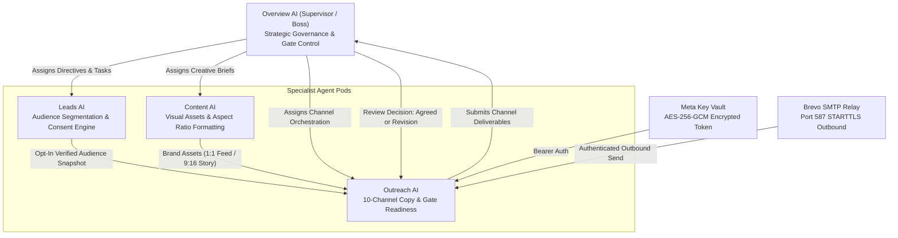

# Matrix360 Omnichannel Marketing Engine: Technical Implementation

This document provides a comprehensive technical breakdown of the architecture, security mechanisms, API contracts, and multi-agent coordination protocols powering Matrix360.

---

## 1. Multi-Agent System Architecture

The platform operates as a collaborative autonomous multi-agent agency:



### Agent Roles & Responsibilities

| Agent Pod | Role | Primary Function | State Artifact |
| :--- | :--- | :--- | :--- |
| **`Overview AI`** | Supervisor / Boss | Evaluates deliverables, assigns directives, exercises gate governance | `task.agent_team_board.supervisor` |
| **`Leads AI`** | Specialist | Ingests CRM contacts, validates opt-in consent, segments audiences | `task.audience_snapshot` |
| **`Content AI`** | Specialist | Produces compliant 1:1 and 9:16 artwork, attaches image references | `task.artifact_refs` |
| **`Outreach AI`** | Specialist | Generates grounded copy across 10 channels, manages 3-gate readiness | `task.channel_draft_versions` |

---

## 2. In-App WhatsApp Meta Cloud API Security Vault

### Cryptographic Specification
Tokens are stored per workspace using **AES-256-GCM authenticated encryption**:

```javascript
const { createCipheriv, createDecipheriv, randomBytes, createHash } = require('node:crypto');

function deriveTenantKey(workspaceId) {
  const secret = process.env.M360_VAULT_MASTER_KEY || 'm360-default-master-secret-vault-key-32';
  return createHash('sha256').update(`${workspaceId}:${secret}`).digest();
}

function encryptSecret(plaintext, workspaceId) {
  const key = deriveTenantKey(workspaceId);
  const iv = randomBytes(12);
  const cipher = createCipheriv('aes-256-gcm', key, iv);
  const encrypted = Buffer.concat([cipher.update(plaintext, 'utf8'), cipher.final()]);
  const authTag = cipher.getAuthTag();
  return {
    iv: iv.toString('hex'),
    authTag: authTag.toString('hex'),
    data: encrypted.toString('hex')
  };
}
```

### Live Meta Graph API Verification
- **Endpoint**: `https://graph.facebook.com/v21.0/{phone_number_id}?fields=verified_name,display_phone_number,quality_rating,code_verification_status`
- **Keyless Test Mode**: When `M360_KEYLESS_TEST_MODE=true` or running under unit tests, provider checks safely simulate successful Meta verification without making external network calls.
- **State Synchronization**: Configuring WhatsApp automatically marks Gate 3 (`gate3_provider`) as `connected` across all active workspace tasks.

---

## 3. Dynamic Targeting Persona Engine (`m360-affinity-engine.js`)

Matrix360 dynamically adapts campaign strategy between industrial B2B and consumer B2C:

### B2B Industrial vs B2C Residential Logic

```javascript
const STRATEGY_PRESETS = {
  b2b_industrial: {
    profile_type: 'b2b_industrial',
    pitch_framing: {
      value_proposition: 'Ready-to-build industrial land with 24/7 power, freight corridors, and compliance incentives.',
      emotional_hook: 'Eliminate supply chain delays and build on industrial infrastructure with assured ROI.',
      call_to_action: 'Download Industrial Masterplan & Schedule Site Inspection'
    },
    core_segments: [
      { id: 'mfg_decision_makers', name: 'Manufacturing Heads & Logistics VPs', affinity_signal: 'Industrial park inquiries' },
      { id: 'warehousing_operators', name: '3PL & Warehouse Operators', affinity_signal: 'Expressway access requirements' },
      { id: 'industrial_investors', name: 'Institutional & Private Industrial Investors', affinity_signal: 'High-yield commercial assets' }
    ]
  },
  b2c_affinity: {
    profile_type: 'b2c_affinity',
    pitch_framing: {
      value_proposition: 'Luxury riverine living in the historic heritage belt with world-class community amenities.',
      emotional_hook: 'Rediscover tranquility by the river — a generational home that honors your heritage.',
      call_to_action: 'Book an Exclusive Private Riverfront Residence Tour'
    },
    core_segments: [
      { id: 'chandannagar_locals', name: 'Chandannagar & Hooghly Locals', affinity_signal: 'Hometown upgrader searches' },
      { id: 'hooghly_upgraders', name: 'District Commercial Upgraders', affinity_signal: 'Gated community and river view affinity' },
      { id: 'metro_diaspora', name: 'Kolkata Diaspora & High-Net-Worth NRIs', affinity_signal: 'Hometown roots and weekend retreat interest' }
    ]
  }
};
```

---

## 4. Bulk Email Delivery Engine (Brevo SMTP Relay)

Outbound email delivery is governed by enterprise deliverability controls:

- **Transport**: Brevo SMTP relay (`smtp-relay.brevo.com:587`) utilizing STARTTLS.
- **Opt-In Verification**: Automatically queries CRM contact records and admits only recipients where `email_consent: true`.
- **Merge Token Support**: Resolves dynamic tags including `{{contact_name}}`, `{{project}}`, and `{{company}}`.
- **Safety Throttling**: Limits sends to 50 recipients per batch with a 5-second pacing interval to prevent IP reputation degradation.
- **Email-to-CTWA Opt-In Bridge**: Automatically identifies contacts who have consented to email but lack WhatsApp opt-in, drafting an invitation email with a pre-formatted Click-to-WhatsApp link.

---

## 5. API Reference (`api/marketing.js`)

All marketing actions are unified under `POST /api/marketing?action={action}`:

| Action | Method | Request Payload | Response / Outcome |
| :--- | :--- | :--- | :--- |
| `dispatch` | `POST` | `{ workspace_id, prompt, business_name, profile_type }` | Creates new campaign task, returns 202 with `correlation_id` |
| `tasks` | `GET` | `?workspace_id={id}&correlation_id={id}` | Returns normalized task object, draft versions, gates, and calendar |
| `revise` | `POST` | `{ workspace_id, correlation_id, channel, revision_prompt }` | Generates a new immutable version for the specified channel |
| `approve` | `POST` | `{ workspace_id, correlation_id, channel, version_hash }` | Passes Gate 1 by recording operator approval of the hash |
| `execute` | `POST` | `{ workspace_id, correlation_id, channel, mode }` | `test_preview`: Prepares non-sending preview; `live`: Dispatches outbound |
| `providers/configure` | `POST` | `{ workspace_id, provider: 'whatsapp', token, phone_number_id, waba_id }` | Encrypts credentials with AES-256-GCM and verifies connection |
| `providers/verify` | `POST` | `{ workspace_id, provider: 'email' \| 'whatsapp' }` | Verifies live connection (Brevo SMTP or Meta Graph API) |
| `switch-persona` | `POST` | `{ workspace_id, correlation_id, persona_mode }` | Shifts between `b2b_industrial` and `b2c_affinity` |
| `agent-team` | `GET` | `?workspace_id={id}&correlation_id={id}` | Fetches the Multi-Agent Team Board state |
| `agent-team` | `POST` | `{ operation: 'review' \| 'message' \| 'assign', ... }` | Records supervisor sign-off or posts inter-agent directives |
| `import-leads` | `POST` | `{ workspace_id, correlation_id, leads: [...] }` | Imports contacts, validates consent, and updates Gate 2 |
| `calendar` | `POST/PATCH`| `{ workspace_id, correlation_id, title, channel, scheduled_for }` | Schedules campaign events on the visual calendar |

---

## 6. Automated Testing Suite

The platform is guarded by **189 automated tests** running in Node.js native test runner:

```powershell
node --test workstreams/avinash/frontend/tests/*.test.js workstreams/avinash/frontend/tests/*.test.cjs
```

### Key Test Coverage Areas
1. **Security & Cryptography**: Verification of AES-256-GCM encryption, session authorization, and fail-closed execution.
2. **Multi-Agent Coordination**: Supervisor deliverable review (`agreed` / `revision_needed`) and inter-agent directive streaming.
3. **Targeting Persona Switching**: Dynamic adaptation from Lakhotia B2B industrial to Shree Heights B2C residential affinity.
4. **Provider Verification**: Brevo SMTP authentication and Meta Graph API validation.
5. **3-Gate Safety Enforcement**: Rejection of execution when any gate fails (draft unapproved, zero consented contacts, disconnected provider).\n
---

## 7. Production Hardening & Zero-Fabrication Guarantees

The codebase incorporates 8 surgical production hardening guarantees verified by `marketing-hardening-50personas.test.js`:

1. **Zero-Fabricated Delivered Statuses**:
   - `lib/m360-email-provider.js` marks offline or sandbox dispatches as `queued_sandbox_not_sent` with `live_dispatched: false`, never `delivered`.
   - `lib/m360-whatsapp-provider.js` marks deep-link generation as `deep_link_prepared_not_sent` with `live_sent: false`, reserving `provider_accepted` strictly for Meta Cloud API `200 OK` responses carrying `messages[0].id`.

2. **Zero-Plaintext Vault Persistence & Verified CTWA Phone Numbers**:
   - `WORKSPACE_PROVIDER_CREDENTIALS` and serialized task state never hold plaintext tokens in memory or on disk; tokens are encrypted via AES-256-GCM and decrypted strictly in-flight.
   - Click-to-WhatsApp (CTWA) `wa.me` links use the verified `display_phone_number` rather than internal account IDs.

3. **Permissive Allowlist & Live WhatsApp Cloud Dispatch**:
   - Setting `MARKETING_ALLOWED_EMAILS=*` permits all consented recipients with verified opt-in evidence while maintaining fail-closed protection.
   - Live WhatsApp dispatch via `executeMarketingChannel()` calls Meta Cloud API with runtime enablement checks, explicit approval phrases, consent verification, and idempotency key deduplication.

4. **Schema Preservation & Recruitment / TalentOS Mode**:
   - `switchPersonaMode()` preserves all canonical marketing pitch fields and aliases (`title`, `profile_label`, `value_proposition`, `target_segments`, `qualification_criteria`, `budget_overview`, `disclaimer`, `framing`, `core_segments`, `channel_mix`) while recalculating budget and A/B sample sizes.
   - Introduces `recruitment_talent` mode with strict candidate purpose isolation preventing candidate data leakage into commercial campaigns. Unclassified prompts safely halt with `clarification_required`.

5. **Multi-Agent Governance & Gate 1 Enforcement**:
   - When a supervisor rejects an outreach deliverable (`decision: 'disagreed'`), review status transitions to `changes_requested`, categorically blocking Gate 1 approval (`SUPERVISOR_REVISION_REQUIRED`) until a revision is generated.
   - Assigning specialist tasks with `executeSpecialist: true` refreshes verified CRM leads and Content Studio assets.

6. **Authenticated Reverse Handoffs**:
   - `POST /api/marketing/handoff` accepts authenticated requests from the Leads and Content engines, attaching verified CRM leads and Content Studio assets without returning HTTP 501.

7. **Signed Meta WhatsApp Webhooks**:
   - `GET /api/marketing/webhooks/whatsapp` responds with `hub.challenge` on valid verify tokens and returns 403 otherwise.
   - `POST /api/marketing/webhooks/whatsapp` validates HMAC SHA-256 signatures (`x-hub-signature-256`), automatically suppresses contacts on inbound `STOP` / `UNSUBSCRIBE`, and grants opt-ins on inbound inquiries.

8. **Python Engine Bridge & Live Overview SSE Progress**:
   - `lib/m360-control-client.js` attaches live `EventSource` listeners to `/api/marketing/events` during campaign dispatch, providing real-time lifecycle progress directly into the Overview workspace.
